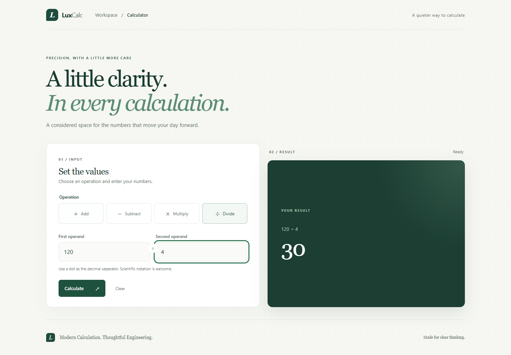
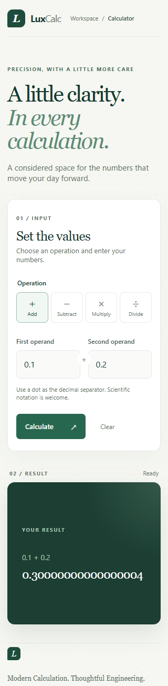

# LuxCalc Full-Stack

**Modern Calculation. Thoughtful Engineering.**

LuxCalc pairs a responsive React + TypeScript workspace with an independently tested Go calculation API. This open-source portfolio project evolves an earlier Delphi calculator built with OOP, MVC and SOLID.

[](https://github.com/victor9205/luxcalc-react-go/actions/workflows/ci.yml)

The source is public at [victor9205/luxcalc-react-go](https://github.com/victor9205/luxcalc-react-go).

| Desktop · 1440 px | Mobile · 320 px |
| --- | --- |
| [](docs/images/luxcalc-desktop.png) | [](docs/images/luxcalc-mobile.png) |

Both layouts show real API-backed calculations. Select either image for the full-size capture.

## UX & Accessibility

- **Responsive workspace:** two desktop panels become one column at 320 px; long and scientific results stay inside the result panel.
- **Keyboard and announcements:** Tab navigation, Enter submission, visible focus, explicit input labels, selected-operation states and announced validation/loading/results/errors.
- **Reliable async interactions:** loading feedback and duplicate-submit protection; editing or clearing cancels pending work and removes stale results. API/network errors and a ten-second timeout provide a correction or retry path.
- **Reduced motion:** nonessential animation and transitions respect the user's motion preference.

Evidence: [seven browser scenarios](tests/e2e/calculator.spec.mjs), [async interaction tests](frontend/src/App.races.test.tsx) and the [current UX check](docs/VERIFICATION.md#post-publication-ux-check).

## Run locally

Prerequisites: Git, Go 1.27+, Node.js 22.22.3+ (or a compatible current LTS), npm. See [environment setup](docs/ENVIRONMENT.md) for the actual validated versions and portable Go fallback used on Windows.

```powershell
npm ci
npm --prefix frontend ci
npm run dev:backend
```

In a second terminal:

```powershell
npm run dev:frontend
```

Open **http://localhost:5173**. The Go API listens on `127.0.0.1:8080`. Vite proxies `/api` to it, so development needs no permissive CORS policy. Set `ADDR` to change the backend address; change the Vite proxy target too if you change the port. For production, build the frontend and configure an HTTPS reverse proxy to serve `frontend/dist` and route `/api` to Go; the Vite development server is not a production server.

## Architecture

The Go API supports addition, subtraction, multiplication and division. React manages input and presentation; the service supplies every calculation result.

```text
React UI → typed fetch client → /api/calculate
                                ↓
                    Go HTTP parsing/validation
                                ↓
                    independent calculator domain
```

`backend/internal/calculator` owns arithmetic and typed domain errors. `backend/internal/httpapi` handles bounded JSON decoding, required operands, response contracts and HTTP semantics. `backend/cmd/server` owns process configuration and server lifecycle. The valid local Go module name is `luxcalc/backend`; change it and its imports together if a future repository owner chooses a fully qualified module path.

`frontend/src` holds React state, presentation, numeric input validation and the typed API client. JavaScript does not compute authoritative arithmetic results. Vite, TypeScript, Vitest and React Testing Library support development; the backend uses only the standard library.

This applies Clean Architecture and SOLID through focused responsibilities and inward dependencies. The domain imports no HTTP package; transport can change without changing arithmetic. No repository, persistence layer, service interface or dependency injection framework is needed for four stateless operations.

## API

```powershell
$body = @{ operation = 'divide'; a = 120; b = 4 } | ConvertTo-Json
Invoke-RestMethod -Method Post -Uri http://127.0.0.1:8080/api/calculate -ContentType application/json -Body $body
```

```json
{"result":30}
```

Request contract: `POST /api/calculate`, `Content-Type: application/json`, one JSON object with `operation` (`add`, `subtract`, `multiply`, `divide`) and required finite numeric `a`, `b`. Zero is a valid operand. Unknown fields and additional JSON values are rejected. Body limit: 8 KiB. Health check: `GET /api/health`.

```json
{"error":{"code":"DIVISION_BY_ZERO","message":"Cannot divide by zero"}}
```

| Status | Meaning |
| --- | --- |
| 400 | `INVALID_INPUT`: malformed/missing/incorrectly typed input |
| 404 | Unknown route |
| 405 | Wrong HTTP method; includes `Allow` |
| 413 | `INVALID_INPUT`: body exceeds limit |
| 415 | `INVALID_INPUT`: JSON content type required |
| 422 | `UNSUPPORTED_OPERATION`, `DIVISION_BY_ZERO`, `NON_FINITE_RESULT` |

## Verification

```powershell
npm run verify
npm run test:e2e
```

`verify` runs Go formatting, vet, tests with coverage, OpenSpec strict validation, frontend lint, type checking, coverage and production build. Individual commands:

```powershell
cd backend
go fmt ./...
go vet ./...
go test ./... -coverprofile=coverage.out
go tool cover -func=coverage.out
cd ../frontend
npm run lint
npm run typecheck
npm test
npm run test:coverage
npm run build
```

Browser tests default to installed Chrome. To use Playwright Chromium, run `npx playwright install chromium` and set `PLAYWRIGHT_CHANNEL=chromium`. GitHub Actions uses Chromium on Ubuntu. [Verification evidence](docs/VERIFICATION.md) distinguishes the initial local report from later hosted checks.

The initial local checks passed **50 frontend tests and 7 browser tests**, with **98.42% frontend statement coverage**, **100% Go domain coverage**, **96.4% HTTP coverage**, and **75.6% Go coverage overall** including the server bootstrap (0% unit coverage). The [successful hosted baseline run](https://github.com/victor9205/luxcalc-react-go/actions/runs/43002167130) independently confirmed the same test counts and coverage on commit `86c77ff`, including formatting, vet, lint, type checking, OpenSpec validation, production build and real browser integration. The badge shows the current `main` workflow status; the linked run is a fixed, verified historical result, not a claim about a later commit.

## Specifications and AI-assisted development

One OpenSpec change, [luxcalc-fullstack-foundation](openspec/changes/luxcalc-fullstack-foundation), defines the API, UX, architecture, acceptance scenarios and tasks. Validate it with `npm run spec:validate`. The [implementation plan](docs/IMPLEMENTATION_PLAN.md) records the executable decisions and task completion evidence.

The user authorized local setup, implementation and verification in one request. [AI_PROMPTS.md](AI_PROMPTS.md) preserves that request verbatim; [AI workflow](docs/AI_WORKFLOW.md) records the actual task prompts, model routing and selected capabilities. No global context proxy or project-specific skill was needed: ordinary scripts provide the repeatable quality gate.

## Numerical limits and future work

The API uses IEEE 754 `float64`; decimal values such as `0.1 + 0.2` can expose binary representation error. Results are general-purpose approximations, unsuitable for financial accounting requiring exact decimal arithmetic. Integers beyond `2^53 − 1` may lose exactness. Overflow is rejected rather than serialized as infinity. Very small values may underflow to zero. Input and result formatting must not imply extra precision.

Future improvements could add exact decimal arithmetic as an explicit separate mode, broader operations and persistent history. Authentication, databases, Docker and unnecessary infrastructure are outside this small portfolio project's scope.

MIT licensed; see [LICENSE](LICENSE).
